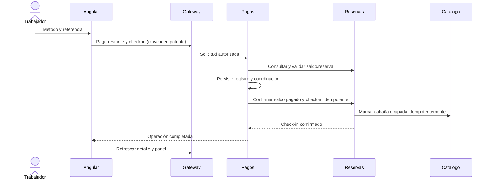

# HU7: Registro del pago restante y check-in

## Objetivo
El trabajador registra el saldo restante mediante efectivo, tarjeta o Yape/Billetera desde el detalle administrativo. Al completarse la operación, la reserva queda totalmente pagada y en estadía y la cabaña ocupada.

## Plan de implementación
1. T40 — Definir contrato y secuencia entre Angular, gateway, pagos, reservas y catálogo. Aplicar el rol GUARDIAN existente para trabajadores.
2. T41 — Registrar pago restante con saldo calculado en servidor, referencia de operación condicional e identificador de idempotencia. Validar reserva confirmada, saldo y disponibilidad para check-in. Bloquear concurrencia y evitar cobros duplicados.
3. T41 — Confirmar pago total y check-in en reservas; actualizar ocupación en catálogo. Una transacción local no cubre varios microservicios: persistir estado de coordinación y permitir reintentos idempotentes ante fallos remotos. No devolver éxito antes de completar la coordinación.
4. T39 — Añadir formulario adaptable al modal de detalle, mostrando saldo, método y número de operación obligatorio salvo efectivo. Mostrar errores y bloquear doble envío.
5. T42 — Conectar el formulario mediante gateway; refrescar detalle y panel tras éxito.
6. T43 — Probar validación, permisos, reserva inválida, saldo cero, doble envío, concurrencia y fallo/reintento de servicios. Crear colección Postman para el recorrido completo.

## Criterios de aceptación
- Efectivo permite omitir referencia; tarjeta y Yape/Billetera requieren una referencia no vacía de hasta 100 caracteres.
- El importe procede del saldo del servidor, nunca de un importe enviado por el navegador.
- Solo personal autorizado puede registrar el pago y check-in.
- Una solicitud repetida no crea otro pago.
- El panel muestra saldo cero y estado En estadía después de éxito; la cabaña queda ocupada.
- Un fallo parcial queda registrado y puede recuperarse sin repetir el pago.

## Secuencia propuesta


## Implementación entregada
- T39: formulario adaptable dentro del modal de administración, con métodos efectivo, tarjeta y Yape/Billetera. Referencia condicional, bloqueo de doble envío, recuperación del registro y mensajes de error/éxito.
- T40: secuencia anterior implementada mediante operaciones idempotentes entre pagos, reservas y catálogo.
- T41: tabla `pago_restante` con reserva y clave únicas, trabajador, importe calculado en servidor, método, referencia, fecha y marca de coordinación completada. Reserva bloqueada durante el check-in, saldo cero y estado `OCUPADA` en una transacción local. Catálogo bloquea la cabaña y conserva el identificador de reserva ocupante.
- T42: HTTP vía gateway y actualización inmediata del detalle y panel tras éxito. Gateway permite exclusivamente GUARDIAN y elimina la posibilidad de suplantar el rol mediante cabeceras.
- T43: pruebas de validación, recuperación, fechas, monto, ocupación e integración real; colección Postman en `docs/postman/HU7.postman_collection.json`.

## Reglas y decisiones
- Check-in permitido desde la fecha de ingreso hasta antes de la fecha de salida, usando America/Lima.
- No se envía monto desde Angular; se consulta el saldo del servidor. Saldo cero permite completar check-in sin inventar un importe pendiente.
- `saldoPendiente = 0` representa pago total; `estadoReserva = OCUPADA` representa estancia iniciada, conservando el modelo de estados existente.
- La ocupación se almacena en `cabana.id_reserva_ocupante`; `getEstadoOcupacion()` devuelve OCUPADA/DISPONIBLE. Se conserva ACTIVA/MANTENIMIENTO como estado operativo para permitir futuras reservas.
- Este flujo registra un pago físico recibido; tarjeta y billetera requieren comprobante. No ejecuta un segundo cobro por Mercado Pago.
- No existe una transacción ACID entre bases independientes. El pago queda durable antes de la llamada remota; reservas confirma saldo y estancia en su propia transacción, y la ocupación remota es idempotente por reserva. Si se pierde una respuesta, reintentar desde el modal completa el mismo registro. No se anuncia éxito hasta confirmar los tres servicios.
- La liberación de ocupación corresponde al flujo posterior de check-out.

## Contrato HTTP
`GET /api/v1/pagos/reservas/{idReserva}/restante`: registro existente, o respuesta vacía si no existe.

`POST /api/v1/pagos/reservas/{idReserva}/restante`:
```json
{
  "metodoPago": "TARJETA",
  "numeroOperacion": "OP-123456",
  "claveIdempotencia": "3fd43295-6a74-47f7-b695-88d325d69716"
}
```
Métodos: EFECTIVO, TARJETA, YAPE_BILLETERA. La respuesta incluye id, monto y completado. Reenviar la misma reserva conserva el mismo pago; cambiar sus datos da 409. Validación 400, sin sesión 401, rol incorrecto 403, reserva/cabaña inexistente 404, estado/fechas/ocupación incompatibles 409 y fallo remoto 503.

Las rutas internas requieren token compartido y están bloqueadas en el gateway. Debe configurarse el mismo INTERNAL_SERVICE_TOKEN en pagos, reservas y catálogo. El entorno local usa `ddl-auto: update`, que incorpora tabla y columnas nuevas al arrancar.

## Evidencia de validación (05/11/2026)
- Angular: build correcto; 16 pruebas pasan, incluidas 4 nuevas de HU7.
- Pagos: 5 pruebas nuevas de HU7 y carga de contexto con H2 pasan.
- Reservas: 18 pruebas pasan, incluidas 4 nuevas de check-in.
- Catálogo: prueba nueva de ocupación e idempotencia pasa.
- Gateway: compilación correcta y permisos verificados en integración real.
- Integración local: efectivo, tarjeta y billetera; referencia vacía rechazada, cliente rechazado aun enviando cabecera de guardián, rutas internas bloqueadas y reintentos concurrentes sin duplicar pago. Consultas SQL verifican saldo cero, reserva OCUPADA, cabaña ocupada y un solo pago. Fixtures temporales eliminadas.
- Hay un fallo previo en `OrdersFlowTests.webhookValidaFirmaConIdAlfanumericoEnMinusculas`: la prueba envía tipo `order`, pero el controlador existente filtra por `payment`. Se conservaron los cambios previos del webhook; no se declara verde toda la suite histórica de pagos.
