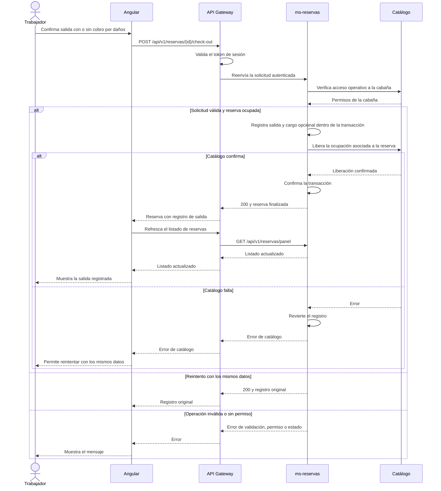

# HU9 · Registro de check-out

El trabajador abre una reserva en estadía desde el panel. Si recibió un pago por daños, marca la casilla e indica la descripción, el importe en soles y el medio de pago presencial. Al confirmar, la reserva pasa a Finalizada y la cabaña queda Disponible. El cargo queda en el registro de salida, separado de los importes de alojamiento.

## Diagrama de secuencia

## Validación

Importa [HU9.postman_collection.json](postman/HU9.postman_collection.json) y ejecuta la colección en orden con el API Gateway, reservas, catálogo y usuarios activos. Prepara dos reservas de prueba en estado OCUPADA, en cabañas distintas asignadas al trabajador del token. Completa los IDs de ambas reservas y cabañas, y los tokens de trabajador y cliente.

En Angular, abre el detalle de una reserva en estadía. Comprueba en pantalla estrecha que puedes marcar y desmarcar la casilla, que los campos aparecen solo cuando hay cobro y que el importe admite dos decimales. Prueba ambas salidas con reservas de prueba distintas. Tras confirmar, comprueba que la lista cambia a Finalizada sin recargar la página y que al reabrir el detalle se ve el registro persistido.
